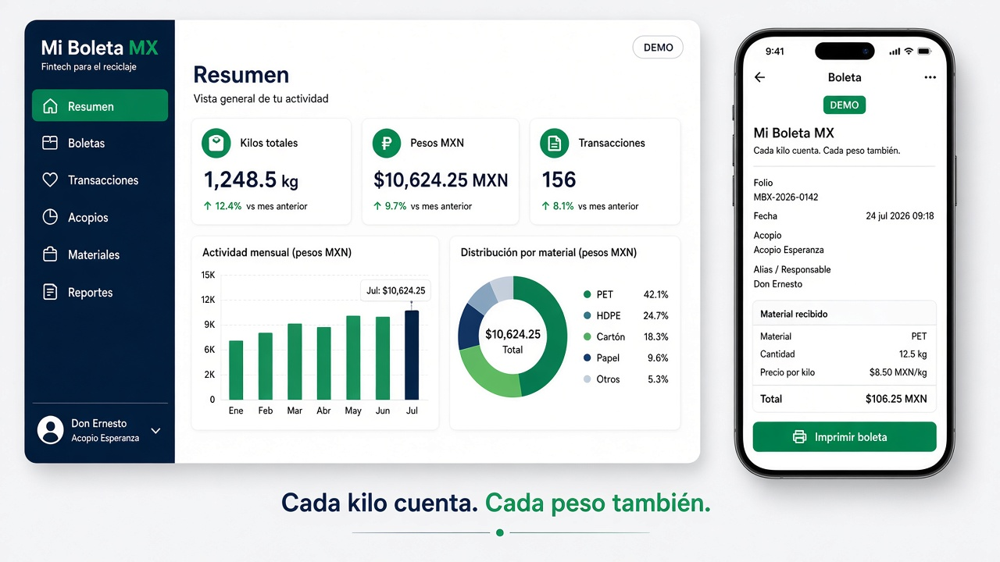
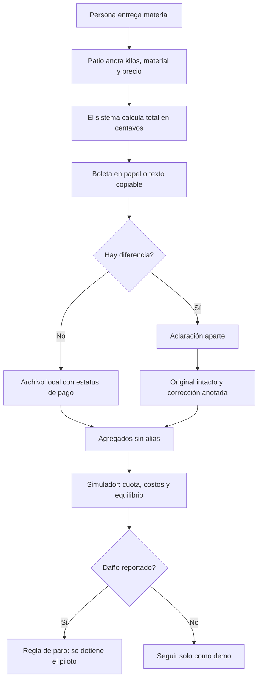
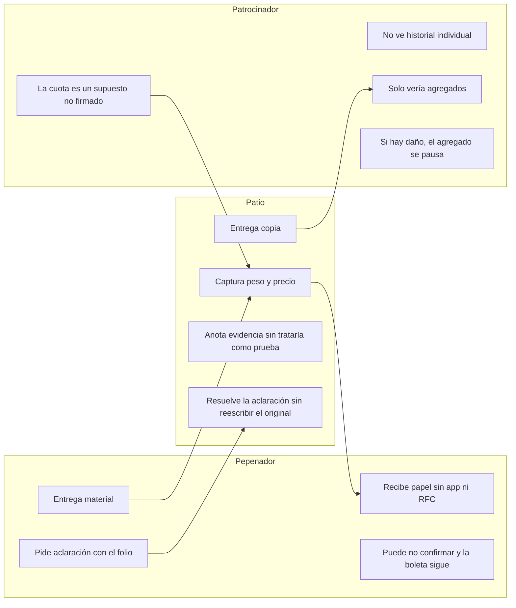

# Mi Boleta MX — paquete de la semana 11

Estudiante: Miguel Bravo. Rol: MONEY. Curso: AI 2041, Business Bending, semana 11. Capítulo: Dreaming of Plenitude. Tema: When Scarcity Ends — And What We Lose Anyway.

El blueprint del equipo T4 que usa este paquete es un borrador de discusión. En este repositorio no hay constancia de una votación ni de una aprobación unánime. La selección provisional del vacío primario es PEPENADOR RAILS.

## 1. Problema

En México, quienes recuperan materiales en la economía informal —los pepenadores— a menudo entregan kilos sin un papel que diga cuánto pesó, a cuánto se pagó el kilo y cuánto debía recibirse. Si el número está mal, no queda un registro que se pueda aclarar. El brief de Crystal Ball de la semana señala cuatro vacíos: LOSS-VISIBILITY, HOUSEHOLD, PEPENADOR y EPR-COMPLIANCE. Este proyecto trabaja el vacío del pepenador: la falta de un riel de transacción transparente entre quien entrega el material y el patio de acopio.

La pregunta de dinero no es si se puede digitalizar la báscula. Es quién paga esa transparencia, por qué un patio participaría y si, después de cuotas, incentivos y costos, la persona que recoge el material termina recibiendo más.

## 2. Usuario exacto

Usuario primario de la boleta: una persona que entrega material reciclable en un patio y necesita un comprobante claro, en papel o en un texto que pueda reenviar ella misma. No se le pide RFC, cuenta bancaria, teléfono inteligente ni instalar la aplicación.

Usuario operador: quien está en el patio y captura peso, material y precio.

Usuario del modelo: quien tendría que patrocinar o adoptar el sistema y necesita ver, antes de cualquier acuerdo, si la cuota cubre el costo. En esta demo ese usuario no existe fuera del simulador. No hay un patio ni una marca inscritos.

Persona de prueba, sintética: Don Ernesto, 56 años, recoge PET y cartón, usa WhatsApp, desconfía de aplicaciones nuevas y prefiere un papel. Ver `PERSONA_TEST.md`. No hubo entrevista humana.

## 3. Definición de éxito

En esta fase el éxito es un prototipo local que:

- emite una boleta con kilos, material, precio, total, fecha, patio y ruta de aclaración;
- calcula el total con aritmética de centavos, no con un modelo de lenguaje;
- separa el valor del material del ingreso supuesto de la plataforma;
- permite aclarar sin borrar la boleta original;
- no califica, geolocaliza ni excluye a quien no confirma la copia;
- muestra una regla de paro si se reporta represalia, exclusión o mal uso;
- deja claro que los datos son ficticios y que las cuotas no son contratos.

Éxito de campo, no alcanzado y no afirmado: un patio real usa la boleta, un patrocinador paga la cuota y las aclaraciones devuelven dinero observado.

## 4. Mockup

Se generó una imagen de concepto durante la construcción. No es una captura del producto terminado.

Capturas posteriores del producto construido, tomadas contra el preview de producción en este equipo:

- `screenshots/landing-desktop.png`
- `screenshots/resumen-desktop.png`
- `screenshots/nueva-desktop.png`
- `screenshots/nueva-mobile.png`
- `screenshots/modelo-desktop.png`
- `screenshots/resumen-mobile.png`
- `screenshots/precios-desktop.png`

## 5. Flujo

## 6. Carriles

## 7. Referencias globales

Estas notas sirven para comparar mecanismos, no para copiar cifras ni afirmar que Mi Boleta MX logra lo mismo. Las leí en fuentes públicas el 25 de octubre de 2026. No audité sus números.

Colombia. El Decreto 596 de 2016 dejó la remuneración de la actividad de aprovechamiento atada a la metodología tarifaria de la Comisión de Regulación de Agua Potable y Saneamiento Básico, dentro del servicio público de aseo. Una guía del Ministerio de Vivienda describe el Valor Base de Remuneración de Aprovechamiento, con la metodología de la Resolución CRA 720 de 2015, como la suma del costo de recolección y transporte más el costo de disposición final, por tonelada, para que las organizaciones calculen lo que les corresponde vía tarifa. El Decreto 1381 de 2024 pide a la CRA actualizar esa metodología, dice que la remuneración incluirá aspectos de dignificación del trabajo de los recicladores de oficio asociados, y dice que no reconocerá los costos de los centros de acopio temporal. Hasta esa actualización, sigue la metodología vigente.

Fuentes: [Decreto 596 de 2016, Superintendencia de Servicios Públicos](https://normograma.superservicios.gov.co/NORMOGRAMA/compilacion/docs/decreto_0596_2016.htm), [guía de Minvivienda](https://www.minvivienda.gov.co/sites/default/files/documentos/guia-para-el-calculo-de-la-tarifa-de-aprovechamiento.pdf), [Decreto 1381 de 2024](https://www.cancilleria.gov.co/normograma/compilacion/docs/decreto_1381_2024.htm).

Qué importa para este proyecto: en Colombia hay una respuesta explícita a “quién paga” —la tarifa del aseo— y una unidad medida, la tonelada. También hay una advertencia: formalizar el pago puede dejar fuera costos del acopio temporal. Mi Boleta MX no crea una tarifa ni afirma un valor por tonelada.

Brasil, Cataki. El sitio de Pimp My Carroça y cataki.org describen Cataki como una aplicación gratuita, lanzada en 2017, que acerca a generadores de residuos con catadoras y catadores. El propio proyecto dice que la aplicación es gratuita y que el trabajo no lo es: el pago se acuerda con la persona. También dice que las catadoras y catadores recolectan el 90 % de lo que se recicla en Brasil; eso es una afirmación del proyecto, no una cifra que yo haya verificado. Una nota del 12 de marzo de 2024 en el sitio de Pimp My Carroça habla de más de 40 mil usuarios y presencia en más de mil ciudades. La ficha de la tienda, leída en esta investigación, hablaba de más de 45 mil usuarios y de 100 mil descargas o más. No concilié esas cifras ni las traté como auditoría.

Fuentes: [Cómo funciona Cataki](https://pimpmycarroca.com/como-o-aplicativo-cataki-funciona/), [cataki.org](https://www.cataki.org/), [página del proyecto](https://pimpmycarroca.com/cataki/).

Qué importa: Cataki hace visible el oficio y deja el pago como un acuerdo directo. También usa la ubicación para encontrar a la persona más cercana. Mi Boleta MX no geolocaliza y no es un directorio. Su pieza es el recibo de kilos por precio en el patio.

India, SWaCH. La página de la cooperativa en Pune describe un acuerdo con la municipalidad desde 2008, nacido de un piloto de 2005 con KKPKP y SNDT. En esa página, SWaCH afirma que el modelo ahorra al municipio 20 crore de rupias al año y que recolecta más de 850 toneladas diarias, de las cuales alrededor de 150 se reciclan y alrededor de 130 se compostan. Esas cifras son las publicadas por SWaCH; no las verifiqué. Un documento más antiguo en su sitio usa otros conteos de miembros y otras cuotas domiciliarias. Un reportaje de The Indian Express de 2024 describe un alza de la cuota domiciliaria y multas si se atribuye suciedad a las personas recolectoras, incluida la posibilidad de retirar el trabajo de la zona. Lo cito como cobertura periodística, no como texto íntegro del contrato.

Fuentes: [SWaCH-PMC Partnership](https://swachcoop.com/about/swach-pmc-partnership/), [The Indian Express, 2024](https://indianexpress.com/article/cities/pune/pune-garbage-collection-door-to-door-waste-collection-pmc-waste-collection-fee-9457692/).

Qué importa: SWaCH muestra un ingreso doble —cuota por el servicio y venta del material— sostenido por una cooperativa, no por una app de vigilancia. Las multas descritas en la prensa son justo el daño que la cláusula de sombra de este prototipo intenta no reproducir. Mi Boleta MX no multa, no rankea y no retira el acceso a la boleta.

## 8. Visión a tres años

En tres años, Mi Boleta MX podría ser el papel y el archivo con los que un patio deja por escrito kilos, precio y total, sin convertir a quien entrega el material en una persona vigilada o calificada. El segundo año solo serviría para un piloto chico, con cuota y patios aceptados por escrito, que mida si la transparencia corrige pagos y si aparece represalia o exclusión. Si ese piloto no muestra menos errores de pago, o si aparece daño, el tercer año no es de expansión: el sistema se detiene.

## 9. Recortes de alcance

- No hay cuentas, login ni base multiusuario.
- No hay pagos bancarios ni transferencia.
- No se envían mensajes de WhatsApp; solo se copia un texto.
- No se suben fotografías.
- No hay índice nacional de precios.
- La interpretación de texto es simulación si no existe una clave de servidor.
- No hay app nativa. El papel sustituye al teléfono.
- No se modela el vacío de hogares, el de visibilidad de pérdidas ni el de cumplimiento de responsabilidad extendida del productor, salvo como contexto del brief.

## 10. Arquitectura y tecnología

| Pieza | Elección |
| --- | --- |
| Interfaz | React 19, Vite 8, TypeScript, Tailwind CSS 4 |
| Navegación | React Router 7 |
| Gráficas | Recharts |
| Iconos | Lucide |
| Dinero | Enteros en centavos y gramos. Redondeo mitad hacia arriba |
| Datos de la demo | localStorage en el navegador. No es una base certificada |
| Texto de boleta | Reglas fijas en el cliente y en `/api/interpret`. Un modelo remoto solo si el servidor tiene `AI_API_KEY` |
| Pruebas | Vitest, Testing Library, Playwright |
| Publicación prevista | Vercel, sitio estático más la función `/api/interpret` |

Detalle en `ARCHITECTURE.md`.

## 11. Plan de pruebas

El plan está en `TEST_PLAN.md` y los resultados reales en `TEST_RESULTS.md`. En resumen se probaron el total, el redondeo, el rechazo de peso cero y precio negativo, la creación y el filtro de boletas, la aclaración que no toca el original, el ingreso, el costo y el equilibrio del modelo, la cuota en cero, el cambio de escenario, el reinicio de la demo, el CSV, el borrado local, la ausencia de puntaje y de geolocalización, y la navegación de escritorio y de teléfono.

## 12. Alineación con el blueprint

Las seis condiciones propuestas están en la aplicación y se explican en `BLUEPRINT_ALIGNMENT.md` y en la pantalla Condiciones. Siguen siendo condiciones de un borrador, no cláusulas firmadas.

## 13. Seguridad

El prototipo no guarda secretos en el navegador ni en el repositorio. La clave de IA, si alguien la configura, solo se lee en el servidor. El archivo local no es privado frente a otra persona que use el mismo navegador. No hay datos personales reales en la demo. Detalle en `SECURITY.md`.
